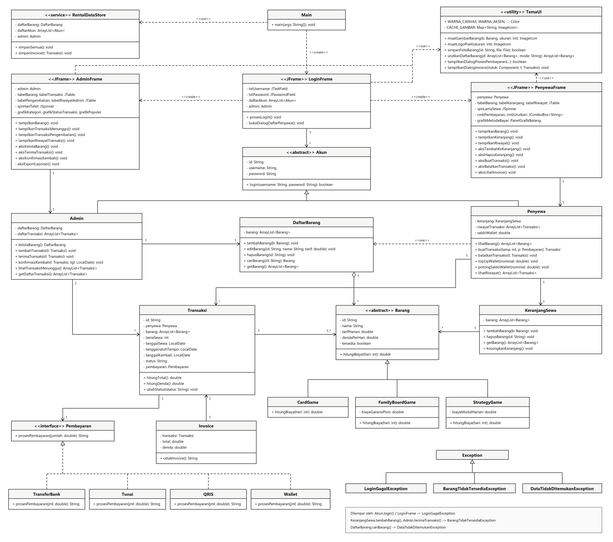

# 🎲 BoardGameRent

**Aplikasi desktop penyewaan board game berbasis Java Swing (GUI)** untuk tugas akhir UAS Praktikum Pemrograman Berorientasi Objek (PBO) Kelas B - **Kelompok 10**.

Dibangun dengan pemisahan layer `model`, `payment`, `exception`, dan `view` menggunakan antarmuka bertema **Warm Tabletop** serta dokumentasi **Javadoc** sesuai *Objects First with Java - Program Style Guide*.

---

## ✨ Fitur Utama

### 🔐 Autentikasi Multi-Peran (`LoginFrame`)
- Login terpusat memakai satu daftar akun bersama (`ArrayList<Akun>`) untuk peran **Admin** dan **Penyewa**.
- Dilengkapi pengecekan `LoginGagalException` saat input kosong atau kredensial salah, tombol cepat `Enter`, dan opsi **Tampilkan password**.

### 🛠️ Panel Admin (`AdminFrame`)
- **Kelola Barang**: Tambah, ubah nama/tarif, dan hapus board game pada katalog (`CardGame`, `FamilyBoardGame`, `StrategyGame`).
- **Transaksi Menunggu**: Tinjau pesanan masuk dan validasi ulang ketersediaan stok sebelum menyetujui penyewaan.
- **Pengembalian**: Catat tanggal kembali aktual (`LocalDate`), hitung denda keterlambatan otomatis per hari, proses pelunasan denda, dan pulihkan status barang menjadi `Tersedia`.

### 🛒 Panel Penyewa (`PenyewaFrame`)
- **Daftar Barang**: Lihat koleksi board game yang siap disewa beserta tarif harian, biaya tambahan kategori, dan tarif denda.
- **Keranjang Sewa**: Tambah/hapus item ke `KeranjangSewa`, atur lama sewa (`1 - 365` hari) dengan estimasi total biaya langsung, pilih metode pembayaran, dan buat transaksi.
- **Riwayat & Invoice**: Pantau status penyewaan (`Menunggu Konfirmasi`, `Sedang Disewa`, `Ditolak`, `Selesai`) dan cetak struk terformat melalui tombol **Lihat Invoice**.

---

## 🧩 Penerapan Konsep OOP

| Konsep | Implementasi di Proyek |
|---|---|
| **Abstraction** | Abstract class `Barang` (`hitungBiaya(int)`) dan `Akun`, serta interface `Pembayaran` (`prosesPembayaran(double)`) |
| **Inheritance** | `CardGame`, `FamilyBoardGame`, `StrategyGame` mewarisi `Barang`; `Admin`, `Penyewa` mewarisi `Akun` |
| **Polymorphism** | Rumus tarif berbeda pada tiap subclass `Barang` dan perilaku pembayaran pada `TransferBank`, `Tunai`, serta `QRIS` |
| **Encapsulation** | Seluruh field `private` disertai validasi ketat di constructor dan setter/getter `public` |
| **Collection** | `ArrayList<Barang>`, `ArrayList<Transaksi>`, dan `ArrayList<Akun>` dengan salinan aman (*defensive copy*) |
| **Exception Handling** | `LoginGagalException`, `BarangTidakTersediaException`, dan `DataTidakDitemukanException` |

---

## 📁 Struktur Proyek

```text
OOP-FINALS-10/
+-- Assets/
|   `-- class_diagram_BoardGameRent_GUI.png
+-- src/
|   +-- Main.java
|   +-- exception/
|   |   +-- BarangTidakTersediaException.java
|   |   +-- DataTidakDitemukanException.java
|   |   `-- LoginGagalException.java
|   +-- model/
|   |   +-- Admin.java
|   |   +-- Akun.java
|   |   +-- Barang.java
|   |   +-- CardGame.java
|   |   +-- DaftarBarang.java
|   |   +-- FamilyBoardGame.java
|   |   +-- Invoice.java
|   |   +-- KeranjangSewa.java
|   |   +-- Penyewa.java
|   |   +-- StrategyGame.java
|   |   `-- Transaksi.java
|   +-- payment/
|   |   +-- Pembayaran.java
|   |   +-- QRIS.java
|   |   +-- TransferBank.java
|   |   `-- Tunai.java
|   `-- view/
|       +-- AdminFrame.java
|       +-- LoginFrame.java
|       +-- PenyewaFrame.java
|       `-- TemaUI.java
+-- .gitignore
`-- README.md
```

<details>
<summary>🗺️ Lihat Class Diagram (Versi GUI)</summary>

<br>



</details>

---

## 🎮 Data Awal & Akun Demo

### Katalog 6 Board Game (3 Kategori)

| ID | Nama Board Game | Kategori | Tarif/Hari | Biaya Tambahan | Denda/Hari |
|---|---|---|---|---|---|
| `BG01` | UNO No Mercy | `CardGame` | Rp15.000 | - | Rp5.000 |
| `BG02` | Exploding Kittens | `CardGame` | Rp20.000 | - | Rp5.000 |
| `BG03` | Monopoly Classic | `FamilyBoardGame` | Rp25.000 | Garansi pion Rp10.000 (1x bayar) | Rp8.000 |
| `BG04` | Cluedo | `FamilyBoardGame` | Rp30.000 | Garansi pion Rp12.000 (1x bayar) | Rp8.000 |
| `BG05` | Catan | `StrategyGame` | Rp40.000 | Modul Rp5.000/hari | Rp12.000 |
| `BG06` | Ticket to Ride | `StrategyGame` | Rp35.000 | Modul Rp5.000/hari | Rp10.000 |

### Akun Login Tersedia

| Peran | ID | Username | Password |
|---|---|---|---|
| 🛡️ Admin | `ADM01` | `admin` | `admin123` |
| 👤 Penyewa 1 | `P01` | `budi` | `budi123` |
| 👤 Penyewa 2 | `P02` | `siti` | `siti123` |

---

## 🚀 Cara Menjalankan Aplikasi

Pastikan **JDK 17** atau versi lebih baru sudah terpasang di sistem Anda.

### 1. Kompilasi & Jalankan GUI

**Windows (PowerShell):**
```powershell
javac -d out -sourcepath src src/Main.java src/view/*.java src/payment/*.java src/model/*.java src/exception/*.java
java -cp out Main
```

**Linux / macOS / Git Bash:**
```bash
javac -d out -sourcepath src $(find src -name "*.java")
java -cp out Main
```

### 2. Generate Dokumentasi Javadoc

**Windows (PowerShell):**
```powershell
$files = Get-ChildItem -Recurse src\*.java | ForEach-Object { $_.FullName }
javadoc -d docs -author -version $files
```

**Linux / macOS / Git Bash:**
```bash
javadoc -d docs -author -version $(find src -name "*.java")
```

---

## 🔄 Alur Demo Sistem (Skenario 1 sampai 8)

1. **Login Penyewa**: Masuk memakai akun `budi` atau `siti` melalui jendela `LoginFrame`.
2. **Lihat Katalog**: Cek daftar board game berstatus `Tersedia` pada tab **Daftar Barang**.
3. **Isi Keranjang**: Pilih satu atau lebih board game lalu klik **Tambah ke Keranjang**.
4. **Atur Lama Sewa**: Buka tab **Keranjang**, tentukan lama sewa (hari), dan cek estimasi biaya totalnya.
5. **Pilih Pembayaran & Checkout**: Pilih metode `QRIS`, `Transfer Bank`, atau `Tunai`, lalu klik **Buat Transaksi**.
6. **Konfirmasi Admin**: Logout dan masuk sebagai `admin`, lalu setujui transaksi pada tab **Transaksi Menunggu** (status barang otomatis berubah menjadi `Sedang Disewa` dan terkunci dari penyewa lain).
7. **Cek Riwayat & Invoice**: Login kembali sebagai penyewa, buka tab **Riwayat**, lalu klik **Lihat Invoice** untuk menampilkan struk transaksi.
8. **Pengembalian & Denda**: Masuk lagi sebagai `admin`, buka tab **Pengembalian**, masukkan tanggal kembali (`yyyy-MM-dd`), lalu klik **Konfirmasi Pengembalian** untuk menghitung denda keterlambatan (bila ada) dan mengembalikan status barang menjadi `Tersedia`.

---

## 👥 Anggota Kelompok 10

| Peran | Nama | GitHub | Ruang Lingkup |
|---|---|---|---|
| **Anggota 1** | Muhammad Aqil Mubarak | [@Eruumaa](https://github.com/Eruumaa) | `Barang` & 3 subclass, `DaftarBarang`, `Admin`, `AdminFrame`, `TemaUI`, integrasi & pengumpulan |
| **Anggota 2** | Irvan Almidar | [@irvanalmidar2](https://github.com/irvanalmidar2) | `Pembayaran` & 3 implementasi, `Transaksi`, `Invoice`, `Penyewa`, `PenyewaFrame` |
| **Anggota 3** | M. Yogi Kafrawi | [@YogiShiki](https://github.com/YogiShiki) | `Akun`, 3 Custom Exception, `KeranjangSewa`, `LoginFrame`, `Main`, fondasi `README.md` |
